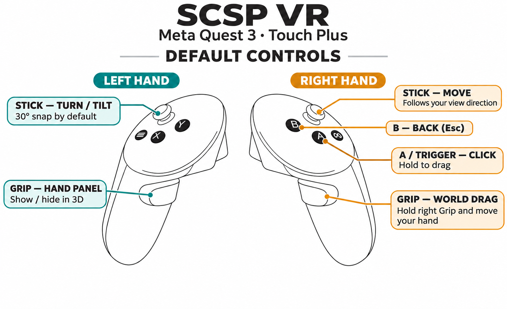

## [English](README.md) | [한국어](README.ko.md) | [日本語](README.ja.md)

# SCSP VR

Creator: [@TBluebox12](https://x.com/TBluebox12)\
Arca.live Virtual Reality channel: [Virtual Reality channel](https://arca.live/b/vrshits)\
Support: [buymeacoffee.com/vrshits](https://buymeacoffee.com/vrshits)

An unofficial OpenXR VR mod for the DMM PC version of **THE iDOLM@STER Shiny Colors: Song for Prism**.

[Download a release](https://github.com/deadpixel134/scsp-vr/releases) · [Full installation guide](docs/en/INSTALLATION.md) · [Full controls guide](docs/en/USAGE.md) · [Report an issue](https://github.com/deadpixel134/scsp-vr/issues)

## Requirements and support

- Windows x64 and a working **DMM PC edition** of Song for Prism. Steam and mobile editions are unsupported.
- A PC VR headset, tracked controllers, and an active OpenXR runtime with Direct3D 12 support. Controller bindings target the Oculus Touch layout (A/B, Grip, trigger, and thumbsticks).
- The complete release ZIP. Required loader components are included; `scsp-localify` is optional.

If you use `scsp-localify`, disable **Free Camera** before launching: set `baseFreeCamera.enable` to `false` in `scsp-config.json`. SCSP VR does not change or restore this setting for you.

## 1. Install

1. Download `SongPrismVR-v*.zip` and its matching `.zip.sha256` file from [Releases](https://github.com/deadpixel134/scsp-vr/releases). Read that release's notes before installing.
2. Fully close the game and make sure `imasscprism.exe` is no longer running.
3. Extract the entire ZIP to a **separate folder outside the game directory**.
4. Run `SongPrismVR.Installer.exe` from that folder.
5. Select the game directory containing `imasscprism.exe`, `GameAssembly.dll`, and `UnityPlayer.dll`, then select **Install**.
6. Select **Open settings** after installation. You can start with the defaults.

The source installer can prefill a game folder from DMM's installed-game list after checking the three game files. Confirm the folder before installing; use **Browse** if no unique installation is found. Older released installers may require manual selection.

The installer checks the package before copying files and backs up replaced files under `game directory\vrmod\rollback\`. It supports both clean installations and existing `scsp-localify` installations, preserving existing Localify files and VR settings. See the [installation guide](docs/en/INSTALLATION.md) for checksum verification and recovery details.

### Already installed? Update

**Automatic:** fully close the game, then open `game directory\vrmod\tools\SongPrismVR.Configurator.exe`. Opening the configurator checks GitHub and automatically downloads, verifies, and installs a newer eligible release, then reopens the configurator. **Stable releases and prereleases are both eligible; there is no Update / Later confirmation.** Progress and errors appear in the status bar. Use **Check for updates** to check again. Installation is deferred while the game is running.

**Manual:** download a new ZIP and matching checksum from [Releases](https://github.com/deadpixel134/scsp-vr/releases), extract it to a separate folder, and run the new installer against the **same game directory**. Select **Update** (or **Reinstall** for the same version). Existing VR settings are preserved, and replaced files are backed up for rollback.

## 2. Launch in VR

1. Connect your headset to the PC and start your PC VR connection software.
2. In that software, select the OpenXR runtime you intend to use as the **active OpenXR runtime**. Connect the controllers as well.
3. Open the **DMM launcher** on the PC desktop, including the desktop viewed inside your headset, and launch Song for Prism normally. The installer is not a game launcher.
4. Keep the game window in the Windows foreground to use controller clicks and back input.
5. Check the initial flat panel, then enter a supported 3D scene to check stereo rendering.

With VDXR, choose Virtual Desktop OpenXR in Virtual Desktop Streamer; with SteamVR or Link / Air Link, use that software's OpenXR runtime setting. These are setup pointers, not claims of SCSP VR hardware validation. See [runtime setup](docs/en/INSTALLATION.md#openxr-runtimes).

## 3. Learn the display and controls

Supported **3D scenes appear in stereo VR**, including 3D Live, Photo Studio, and OurStream viewing. The runtime also recognizes matching Home, costume, and story camera layouts; support depends on the actual scene layout. **Menus, video, and scenes without a supported 3D source use a flat panel**. Portrait and landscape content keep their aspect ratio. A brief pause or flat panel can occur during scene changes.

To operate the game UI in 3D, **press left Grip to show the hand panel**, bring your left hand into view, then point and click with the right controller. The hand panel starts off. The front panel used outside stereo rendering appears automatically and is separate from this hand-panel toggle.



Controller artwork: [Meta](docs/images/README.md).

The table shows fresh-install defaults with Touch-style controllers. Existing settings survive updates and may differ.

| Action | Default input |
|---|---|
| Aim at the panel | Point with the right controller |
| Click / hold and drag | A button or right trigger |
| Back | B button (`Esc`), while pointing at a panel |
| Move in 3D | Right thumbstick |
| Turn the view | Left thumbstick — 30° snap by default |
| Show / hide the hand panel in 3D | Left Grip |
| World drag / fine positioning | Hold right Grip and move the right hand |

Use the left stick horizontally to turn left/right and vertically to tilt the view up/down; return it to center between snap turns. Right-stick movement follows your current viewing direction. Looking up or down while moving forward lets you move vertically. World drag is enabled in new defaults. If an existing installation has it disabled, select **Enable world dragging** in the configurator's **Input** tab. Hold right Grip and move your hand to move the viewpoint in the opposite direction; release Grip to keep that position. Stick movement and world drag can be used together.

Live uses head position and rotation (6DoF) by default, without synchronizing your position to the game's camera. If pulling the trigger disturbs your aim, use **A** to click. The mouse remains usable. Thumbstick scrolling is off by default and can be enabled in settings. See [controls and input conflicts](docs/en/USAGE.md).

**OurStream:** skip the initial black waiting screen with PC controls or the hand panel. It may start you below the floor or facing the wrong direction; adjust your position and view angle after entering.

## 4. Change settings

Fully close the game, run the program below, change and **Save** settings, then restart the game. Opening this app also checks for automatic updates as described above.

```text
game directory\vrmod\tools\SongPrismVR.Configurator.exe
```

Choose **Korean, English, or Japanese** in the app.

| What to adjust | Settings |
|---|---|
| Image quality and performance | Per-eye render scale: 0.50–2.00, default 0.65; increase gradually |
| Character size and depth | Separate Live / non-Live space and scale profiles; eye spacing, head movement, and stick movement scales |
| Live viewpoint | Synchronize to game camera position — off by default |
| Hand panel | Panel and pointer hands, initial visibility, position, size, rotation, toggle button |
| Controls | Click/back buttons, trigger click, optional stick scroll, movement hand and speed, world drag, independent view turning |
| Visual effects | VFX preset and individual effects — all off by default |

Selecting the left hand for movement assigns turning to the right stick. Default movement speed is 1.95 m/s; snap angles of 15° / 30° / 45° / 60° and smooth turning are available. Settings are stored in `game directory\vrmod\config\settings.json`. See the [usage guide](docs/en/USAGE.md) for details.

## Uninstall or roll back

Close the game and run `SongPrismVR.Installer.exe` from an extracted release. Select the game directory and use **Roll back** if a previous installation is available, or **Uninstall** otherwise. With multiple installation layers, rollback restores one layer at a time; repeat until **Uninstall** is available to remove the mod completely.

User VR settings, logs, and existing Localify files are preserved. Modified files or missing backups can prevent removal; follow the installer's message instead of deleting files by guesswork. Keep `vrmod/install-state.json` and `vrmod/rollback/` until removal is complete. See [recovery details](docs/en/INSTALLATION.md#uninstall-and-rollback).

## Troubleshooting

| Symptom | Check first |
|---|---|
| No VR display | PC VR connection, active OpenXR runtime, and **Enable VR mode** in settings |
| Display works but clicks do not | Bring the game window to the foreground and point at the displayed panel |
| Hand panel is missing in 3D | Press left Grip and bring the tracked left hand into view |
| World drag does nothing | Check whether existing settings have it disabled; check activation/tracking hands and panel/trigger input conflicts |
| OurStream is black or starts below the floor | Skip the waiting screen, then use movement and view turning |
| Rendering conflicts with Localify | Disable `baseFreeCamera.enable` in `scsp-config.json` before launching |
| Settings do not apply | Save with the game fully closed, then relaunch; confirm the selected game directory |
| Low frame rate or unstable graphics | Lower per-eye render scale and start with VFX off |
| Characters or hair look displaced, or characters disappear in VR | A documented stereo limitation; see [known limitations](docs/DEVELOPMENT.md) |
| Problems after a game update | Check release notes and compatibility reports; close the game and roll back or uninstall if needed |

For [issue reports](https://github.com/deadpixel134/scsp-vr/issues), include the game/mod versions, headset, runtime, affected scene, and reproduction steps. Runtime logs are in `vrmod/logs/`; automatic-update errors also go to `%LOCALAPPDATA%\SongPrismVR\update.log`. Review logs for personal or authentication information before sharing.

## Further documentation and development

- [Installation and recovery](docs/en/INSTALLATION.md) · [Usage and controls](docs/en/USAGE.md)
- [Development, validation scope, and known limitations](docs/DEVELOPMENT.md) (English)
- [Changelog](CHANGELOG.md) · [Release notes](https://github.com/deadpixel134/scsp-vr/releases)
- [Photo Studio and world-drag notes](RELEASE_NOTES_v0.1.2.md) · [OurStream notes](RELEASE_NOTES_v0.1.3.md) (Korean)
- [Legacy English README address](README.en.md)

## License and rights

SCSP VR source is distributed under the [GNU General Public License v3.0](LICENSE). The bundled OpenXR Loader, .NET Runtime, Unity Doorstop, and Dobby retain their respective licenses. See [Credits](CREDITS.md) and [Third-party notices](release-assets/THIRD_PARTY_NOTICES.txt).

Game binaries, game assets, and `scsp-localify` translation data are not included in this repository or its releases.

> This is an unofficial fan project and is not affiliated with or endorsed by Bandai Namco Entertainment, Bandai Namco Studios, THE IDOLM@STER, or any related rights holder. Game names, characters, logos, trademarks, and game data belong to their respective owners. A legitimate game installation is required.
