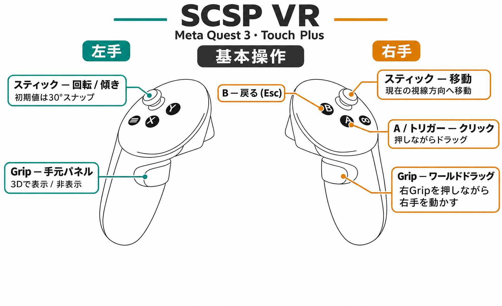

## [English](README.md) | [한국어](README.ko.md) | [日本語](README.ja.md)

# SCSP VR

制作者: [@TBluebox12](https://x.com/TBluebox12)\
Arca.live VRチャンネル: [VRチャンネル](https://arca.live/b/vrshits)\
支援: [buymeacoffee.com/vrshits](https://buymeacoffee.com/vrshits)

**アイドルマスター シャイニーカラーズ Song for Prism** DMM PC版向けの非公式OpenXR VR Modです。

[リリースをダウンロード](https://github.com/deadpixel134/scsp-vr/releases) · [詳しいインストール手順](docs/ja/INSTALLATION.md) · [詳しい操作方法](docs/ja/USAGE.md) · [不具合報告](https://github.com/deadpixel134/scsp-vr/issues)

## 必要なものと対応環境

- Windows x64と、正常に動作するSong for Prismの**DMM PC版**。Steam版・モバイル版には対応していません。
- PC VRヘッドセット、トラッキング可能なコントローラー、Direct3D 12に対応するアクティブなOpenXRランタイム。入力はOculus Touch配置（A/B、Grip、トリガー、スティック）を対象としています。
- 配布ZIP一式。必要なローダー類は同梱されており、`scsp-localify`は必須ではありません。

`scsp-localify`を使う場合は、起動前に**Free Camera**を無効にします。`scsp-config.json`の`baseFreeCamera.enable`を`false`にしてください。SCSP VRはこの設定を自動で変更・復元しません。

## 1. インストールする

1. [Releases](https://github.com/deadpixel134/scsp-vr/releases)から`SongPrismVR-v*.zip`と対応する`.zip.sha256`をダウンロードし、そのリリースの注意事項を読みます。
2. ゲームを完全に終了し、`imasscprism.exe`が実行中でないことを確認します。
3. ZIP全体を**ゲームフォルダー外の別フォルダー**へ展開します。
4. そのフォルダーの`SongPrismVR.Installer.exe`を実行します。
5. `imasscprism.exe`、`GameAssembly.dll`、`UnityPlayer.dll`があるゲームフォルダーを選び、**インストール**を押します。
6. 完了後に**設定を開く**を押します。最初はデフォルト値で始められます。

このソースのインストーラーは、DMMの導入一覧とゲームファイル3点を確認してゲームフォルダーを自動入力できます。導入前にパスを確認し、1か所に確定できない場合は**参照**で選択してください。以前の配布版では手動選択が必要な場合があります。

インストーラーはコピー前にパッケージを検証し、置き換えるファイルを`ゲームフォルダー\vrmod\rollback\`へ保存します。Localifyのない環境にも導入でき、既存のLocalifyファイルとVR設定は保持します。チェックサムの確認と復旧については[インストール手順](docs/ja/INSTALLATION.md)を参照してください。

### インストール済みの場合：更新する

**自動更新：** ゲームを完全に終了し、`ゲームフォルダー\vrmod\tools\SongPrismVR.Configurator.exe`を開きます。起動時にGitHubを確認し、対象となる新しいリリースがあれば自動でダウンロード・検証・インストールして設定アプリを再起動します。**安定版とプレリリースの両方が対象で、「更新／後で」の確認はありません。** 進行状況とエラーはステータスバーに表示されます。**更新を確認**で再確認できます。ゲーム実行中はインストールを延期します。

**手動更新：** [Releases](https://github.com/deadpixel134/scsp-vr/releases)から新しいZIPとチェックサムをダウンロードして別フォルダーへ展開し、新しいインストーラーで**以前と同じゲームフォルダー**を選びます。**アップデート**（同じバージョンは**再インストール**）を押します。既存のVR設定は保持し、置き換えるファイルはロールバック用に保存します。

## 2. VRで起動する

1. ヘッドセットをPCに接続し、PC VR接続ソフトを起動します。
2. 接続ソフトで使用するOpenXRランタイムを**アクティブなOpenXRランタイム**に設定し、コントローラーも接続します。
3. PCのデスクトップ（ヘッドセット内から表示しても可）で**DMMランチャー**を開き、通常どおりSong for Prismを起動します。インストーラーはゲームのランチャーではありません。
4. コントローラーのクリックや戻る操作を使うため、ゲームウィンドウをWindowsの最前面にします。
5. 最初の平面パネルを確認し、対応する3Dシーンでステレオ表示を確認します。

VDXRではVirtual Desktop StreamerのVirtual Desktop OpenXRを、SteamVRやLink / Air Linkでは各ソフトのOpenXRランタイム設定を使用します。これは設定の案内であり、SCSP VRの実機確認済み環境を示すものではありません。[ランタイム設定](docs/ja/INSTALLATION.md#openxr-runtimes)を参照してください。

## 3. 表示と基本操作を覚える

3Dライブ、フォトスタジオ、OurStream視聴など、対応する**3Dシーンは両眼VR**で表示します。ホーム・衣装・ストーリーにも対応するカメラ構成の認識処理がありますが、実際のシーン構成によって対応が変わります。**メニュー、動画、対応する3D出力がないシーンは平面パネル**で表示します。縦・横画面の比率を維持し、シーン切り替え時には短い停止や平面表示になることがあります。

3DでゲームUIを操作するには、**左Gripで手元パネルを表示**し、左手を視野に入れてから右コントローラーで指してクリックします。手元パネルは初期状態ではOFFです。ステレオ表示以外で自動表示される正面パネルは、この切り替えとは別です。



コントローラー図： [Meta](docs/images/README.md)。

以下はTouch系コントローラーでの新規インストール時の初期値です。更新時は既存設定が保持されるため、異なる場合があります。

| 操作 | デフォルト入力 |
|---|---|
| パネルを指す | 右コントローラーで指す |
| クリック／長押しドラッグ | Aボタンまたは右トリガー |
| 戻る | パネルを指しながらBボタン（`Esc`） |
| 3D空間の移動 | 右スティック |
| 視点回転 | 左スティック — デフォルト30°スナップ |
| 3D手元パネルの表示／非表示 | 左Grip |
| ワールドドラッグ／位置の微調整 | 右Gripを押しながら右手を動かす |

左スティックの左右で左右の回転、上下で視点の傾きを調整します。スナップを繰り返すには一度中央へ戻してください。右スティック移動は現在の視線方向に従います。上や下を見ながら前進すると上下に移動できます。新しい初期値ではワールドドラッグが有効です。既存設定で無効な場合は、設定アプリの**操作**タブで**ワールドドラッグを使用**を有効にします。右Gripを押して手を動かすと視点が手と反対方向へ移動し、離すとその位置を保持します。スティック移動と併用できます。

ライブでは頭の位置と回転を反映する6DoFがデフォルトで有効で、位置をゲームカメラに同期しません。トリガーで照準がずれる場合は**Aボタン**を使ってください。マウスも併用できます。スティックスクロールは初期状態ではOFFで、設定で有効にできます。[操作と入力の競合](docs/ja/USAGE.md)も参照してください。

**OurStream：** 最初の黒い待機画面をPC操作または手元パネルでスキップしてください。床下や意図しない向きから始まる場合があるため、開始後に位置と角度を調整してください。

## 4. 設定を変える

ゲームを完全に終了し、以下のアプリで変更して**保存**した後、ゲームを再起動します。このアプリの起動時には、前述の自動更新も確認されます。

```text
ゲームフォルダー\vrmod\tools\SongPrismVR.Configurator.exe
```

アプリでは**韓国語・英語・日本語**を選択できます。

| 調整したい項目 | 設定内容 |
|---|---|
| 画質と性能 | 片目ごとのレンダー倍率：0.50～2.00、初期値0.65。少しずつ上げる |
| キャラクターの大きさと立体感 | ライブ／非ライブ別の空間・スケール、目の間隔・頭の移動・スティック移動倍率 |
| ライブの視点 | ゲームカメラ位置への同期 — 初期状態はOFF |
| 手元パネル | パネルとポインター側の手、初期表示、位置・サイズ・回転・切り替えボタン |
| 操作 | クリック／戻る、トリガー、任意のスティックスクロール、移動側と速度、ワールドドラッグ、独立した視点回転 |
| 画面効果 | VFXプリセットと個別の効果 — 初期状態はすべてOFF |

移動側を左手にすると右スティックが回転を担当します。移動速度の初期値は1.95 m/sです。15° / 30° / 45° / 60°のスナップとスムーズ回転を選べます。設定は`ゲームフォルダー\vrmod\config\settings.json`に保存されます。詳細は[使い方](docs/ja/USAGE.md)を参照してください。

## アンインストールとロールバック

ゲームを終了し、展開した配布フォルダーの`SongPrismVR.Installer.exe`でゲームフォルダーを選択します。以前のインストールがあれば**前のバージョンに戻す**、なければ**アンインストール**を実行します。複数のインストール履歴がある場合は1段階ずつ戻るため、完全に削除するには**アンインストール**が表示されるまで繰り返します。

VR設定、ログ、既存のLocalifyファイルは保持します。ファイルの変更やバックアップ不足で処理が止まる場合は、推測で削除せず表示内容を確認してください。削除完了まで`vrmod/install-state.json`と`vrmod/rollback/`を保持します。[復旧の詳細](docs/ja/INSTALLATION.md#uninstall-and-rollback)を参照してください。

## 困ったとき

| 症状 | 最初に確認すること |
|---|---|
| VR画面が出ない | PC VR接続、アクティブなOpenXRランタイム、設定のVR有効化 |
| 表示されるがクリックできない | ゲームを最前面にし、表示中のパネルを指す |
| 3Dで手元パネルが見えない | 左Gripを押し、トラッキングされている左手を視野に入れる |
| ワールドドラッグが動かない | 既存設定で無効になっていないか、開始ボタンと追跡する手、パネル／トリガー入力の競合を確認 |
| OurStreamが黒い／床下から始まる | 待機画面をスキップして位置と角度を調整 |
| Localifyと描画が競合する | 起動前に`scsp-config.json`の`baseFreeCamera.enable`を無効化 |
| 設定が反映されない | ゲーム終了中に保存して再起動。対象フォルダーも確認 |
| 動作が重い／描画が不安定 | レンダー倍率を下げ、VFXをOFFにして確認 |
| VRでキャラクター・髪がずれる／消える | 記録されているステレオの制限。[制限事項](docs/DEVELOPMENT.md)を確認 |
| ゲーム更新後の不具合 | リリースノートと互換性情報を確認し、必要なら終了してロールバック／削除 |

[不具合報告](https://github.com/deadpixel134/scsp-vr/issues)にはゲームとModのバージョン、ヘッドセット、ランタイム、シーン、再現手順を添えてください。ログは`vrmod/logs/`、自動更新エラーは`%LOCALAPPDATA%\SongPrismVR\update.log`にも記録されます。共有前に個人情報や認証情報を確認してください。

## 詳細ドキュメントと開発情報

- [インストールと復旧](docs/ja/INSTALLATION.md) · [使い方と操作](docs/ja/USAGE.md)
- [開発・確認範囲・制限事項](docs/DEVELOPMENT.md)（英語）
- [変更履歴](CHANGELOG.md)（英語） · [リリースノート](https://github.com/deadpixel134/scsp-vr/releases)
- [フォトスタジオとワールドドラッグ](RELEASE_NOTES_v0.1.2.md) · [OurStream](RELEASE_NOTES_v0.1.3.md)（韓国語）
- [従来の英語READMEアドレス](README.en.md)

## ライセンスと権利について

SCSP VRのソースは[GNU General Public License v3.0](LICENSE)で配布します。同梱されるOpenXR Loader、.NET Runtime、Unity Doorstop、Dobbyには各ライセンスが適用されます。[クレジット](CREDITS.md)と[外部ライセンス通知](release-assets/THIRD_PARTY_NOTICES.txt)を参照してください。

ゲーム本体、ゲームアセット、`scsp-localify`の翻訳データはリポジトリやリリースに含みません。

> 本プロジェクトは非公式のファンプロジェクトであり、Bandai Namco Entertainment、Bandai Namco Studios、THE IDOLM@STER、その他の権利者とは提携しておらず、承認も受けていません。ゲーム名、キャラクター、ロゴ、商標、ゲームデータの権利は各権利者に帰属します。正規にインストールされたゲームが必要です。
