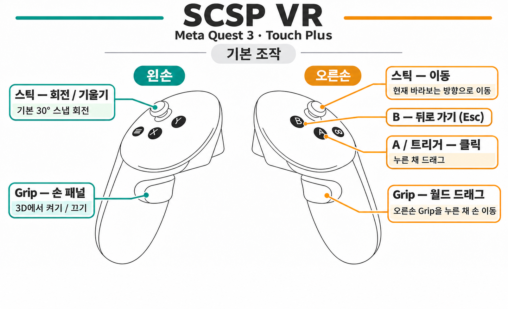

## [English](README.md) | [한국어](README.ko.md) | [日本語](README.ja.md)

# SCSP VR

제작자: [@TBluebox12](https://x.com/TBluebox12)\
아카라이브 가상현실 채널: [가상현실 채널](https://arca.live/b/vrshits)\
후원: [buymeacoffee.com/vrshits](https://buymeacoffee.com/vrshits)

**아이돌마스터 샤이니 컬러즈 Song for Prism** DMM PC판을 OpenXR VR로 플레이하기 위한 비공식 모드입니다.

[릴리스 다운로드](https://github.com/deadpixel134/scsp-vr/releases) · [자세한 설치 안내](docs/ko/INSTALLATION.md) · [자세한 조작 안내](docs/ko/USAGE.md) · [문제 보고](https://github.com/deadpixel134/scsp-vr/issues)

## 준비물과 지원 환경

- Windows x64와 정상 실행되는 Song for Prism **DMM PC판**. Steam·모바일판은 지원하지 않습니다.
- PC VR 헤드셋, 위치 추적 컨트롤러, Direct3D 12를 지원하는 활성 OpenXR 런타임. 컨트롤러 입력은 Oculus Touch 배열(A/B, Grip, 트리거, 스틱)을 대상으로 합니다.
- 배포 ZIP 전체. 필요한 로더 구성은 포함되어 있으며, `scsp-localify` 한글 패치는 필수가 아닙니다.

`scsp-localify`를 사용한다면 실행 전에 **Free Camera**를 끄십시오. `scsp-config.json`의 `baseFreeCamera.enable`을 `false`로 설정합니다. SCSP VR은 이 설정을 자동으로 변경하거나 복구하지 않습니다.

## 1. 설치하기

1. [Releases](https://github.com/deadpixel134/scsp-vr/releases)에서 `SongPrismVR-v*.zip`과 대응하는 `.zip.sha256` 파일을 받고, 해당 릴리스의 주의사항을 읽습니다.
2. 게임을 완전히 종료하고 `imasscprism.exe`가 실행 중이지 않은지 확인합니다.
3. ZIP 전체를 **게임 폴더 밖의 별도 폴더**에 풉니다.
4. 그 폴더의 `SongPrismVR.Installer.exe`를 실행합니다.
5. `imasscprism.exe`, `GameAssembly.dll`, `UnityPlayer.dll`이 있는 게임 폴더를 선택하고 **설치**를 누릅니다.
6. 완료 후 **설정 열기**를 누릅니다. 처음에는 기본값으로 시작할 수 있습니다.

이 저장소의 설치기는 DMM 설치 목록의 경로에 게임 파일 3개가 있는지 확인한 뒤 게임 폴더를 자동 입력할 수 있습니다. 설치 전에 경로를 확인하고, 하나로 확정하지 못하면 **찾기**로 선택하십시오. 기존 배포 설치기에서는 직접 선택해야 할 수 있습니다.

설치기는 파일을 복사하기 전에 패키지를 검증하고, 교체할 파일을 `게임 폴더\vrmod\rollback\`에 보관합니다. 한글 패치가 없는 환경에도 설치할 수 있으며, 기존 Localify 파일과 VR 설정은 보존합니다. 체크섬 확인과 복구 절차는 [설치 안내](docs/ko/INSTALLATION.md)를 참고하십시오.

### 이미 설치했다면: 업데이트하기

**자동 업데이트:** 게임을 완전히 종료하고 `게임 폴더\vrmod\tools\SongPrismVR.Configurator.exe`를 엽니다. 설정 앱은 시작할 때 GitHub를 확인하고, 대상이 되는 새 릴리스가 있으면 자동으로 다운로드·검증·설치한 뒤 다시 열립니다. **안정판과 프리릴리스 모두 대상이며, ‘업데이트 / 나중에’ 확인 창은 없습니다.** 진행 상황과 오류는 상태 표시줄에 나타납니다. **업데이트 확인**으로 다시 확인할 수 있습니다. 게임 실행 중에는 설치를 미룹니다.

**수동 업데이트:** [Releases](https://github.com/deadpixel134/scsp-vr/releases)에서 새 ZIP과 체크섬을 받아 별도 폴더에 풀고, 새 설치기에서 **기존과 같은 게임 폴더**를 선택합니다. **업데이트**를 누르며, 같은 버전이면 **다시 설치**로 표시됩니다. 기존 VR 설정은 유지하고 교체 파일은 롤백용으로 보관합니다.

## 2. VR로 실행하기

1. 헤드셋을 PC에 연결하고 사용하는 PC VR 연결 프로그램을 실행합니다.
2. 연결 프로그램에서 사용할 OpenXR 런타임을 **활성 OpenXR 런타임**으로 지정하고 컨트롤러도 연결합니다.
3. PC 데스크톱 또는 헤드셋 안에 표시한 데스크톱에서 **DMM 런처**를 열어 Song for Prism을 평소처럼 실행합니다. 설치기는 게임 실행 프로그램이 아닙니다.
4. 컨트롤러 클릭과 뒤로가기를 사용하려면 게임 창을 Windows의 포그라운드에 둡니다.
5. 처음 나타나는 평면 패널을 확인하고, 지원되는 3D 장면에 들어가 양안 표시를 확인합니다.

VDXR은 Virtual Desktop Streamer의 Virtual Desktop OpenXR 설정을, SteamVR나 Link / Air Link는 각 프로그램의 OpenXR 런타임 설정을 사용합니다. 이는 연결 설정 안내이며 SCSP VR의 실기 검증을 뜻하지 않습니다. [런타임 설정](docs/ko/INSTALLATION.md#openxr-runtimes)을 참고하십시오.

## 3. 화면 표시 방식과 기본 조작

3D 라이브, 포토 스튜디오, OurStream 시청 등 지원되는 **3D 장면은 양안 VR**로 표시됩니다. 홈·의상·스토리의 대응 카메라 구성도 인식하지만, 실제 장면 구성에 따라 지원 여부가 달라집니다. **메뉴·영상·지원되는 3D 출력이 없는 장면은 평면 패널**로 표시합니다. 세로·가로 화면의 비율을 유지하며, 장면 전환 중 잠시 멈추거나 평면으로 표시될 수 있습니다.

3D에서 게임 UI를 조작하려면 **왼손 Grip으로 손 패널을 켜고**, 왼손을 시야 안에 든 뒤 오른손으로 가리켜 클릭하십시오. 손 패널은 기본적으로 꺼져 있습니다. 스테레오 표시 밖에서 자동으로 나타나는 정면 패널은 이 손 패널 토글과 별개입니다.



컨트롤러 도해: [Meta](docs/images/README.md).

아래 표는 Touch 계열 컨트롤러의 새 설치 기본값입니다. 업데이트 시 기존 설정이 유지되므로 다를 수 있습니다.

| 동작 | 기본 입력 |
|---|---|
| 패널 조준 | 오른손 컨트롤러로 가리키기 |
| 클릭 / 누른 채 드래그 | A 버튼 또는 오른손 트리거 |
| 뒤로 가기 | 패널을 가리킨 상태에서 B 버튼 (`Esc`) |
| 3D 공간 이동 | 오른손 스틱 |
| 시야 회전 | 왼손 스틱 — 기본 30° 스냅 턴 |
| 3D 손 패널 켜기 / 끄기 | 왼손 Grip |
| 월드 드래그 / 위치 미세 조정 | 오른손 Grip을 누른 채 오른손 이동 |

왼손 스틱의 좌우는 좌우 회전, 위·아래는 시야 기울기 조정입니다. 스냅을 반복하려면 스틱을 중앙으로 되돌렸다가 움직이십시오. 오른손 스틱 이동은 현재 바라보는 방향을 따릅니다. 위나 아래를 보며 전진하면 위·아래로 이동할 수 있습니다. 새 기본값에서는 월드 드래그가 켜져 있습니다. 기존 설치에서 꺼져 있다면 설정 앱의 **조작** 탭에서 **월드 드래그 사용**을 켜십시오. 오른손 Grip을 누른 채 손을 움직이면 손의 반대 방향으로 시점이 이동하며, 놓으면 그 위치가 유지됩니다. 스틱 이동과 함께 사용할 수 있습니다.

라이브는 기본적으로 머리 위치·회전을 반영하는 6DoF가 켜져 있으며, 위치를 게임 카메라에 동기화하지 않습니다. 트리거를 당길 때 조준이 흔들리면 **A 버튼**을 사용하십시오. 마우스도 함께 사용할 수 있습니다. 스틱 스크롤은 기본적으로 꺼져 있고 설정에서 켤 수 있습니다. [상세 조작과 입력 충돌 안내](docs/ko/USAGE.md)를 참고하십시오.

**OurStream:** 초기 검은 대기 화면은 PC 조작 또는 손 패널로 건너뛰십시오. 바닥 아래나 원하지 않는 방향에서 시작할 수 있으므로, 진입 후 위치와 시야 각도를 조정하십시오.

## 4. 설정 바꾸기

게임을 완전히 종료한 뒤 아래 프로그램에서 값을 바꾸고 **저장**한 다음 게임을 다시 실행합니다. 이 앱을 열 때는 앞서 설명한 자동 업데이트도 확인합니다.

```text
게임 폴더\vrmod\tools\SongPrismVR.Configurator.exe
```

앱에서 **한국어·영어·일본어**를 선택할 수 있습니다.

| 바꾸고 싶은 항목 | 설정할 내용 |
|---|---|
| 화질과 성능 | 눈별 렌더 배율: 0.50~2.00, 기본 0.65. 조금씩 올려 확인 |
| 캐릭터 크기와 입체감 | 라이브 / 비라이브 공간·크기 프로필, 눈 간격·머리 이동·스틱 이동 배율 |
| 라이브 시점 | 게임 카메라 위치에 동기화 — 기본 꺼짐 |
| 손 패널 | 패널·포인터 손, 시작 상태, 위치·크기·회전·토글 버튼 |
| 조작 | 클릭·뒤로 버튼, 트리거 클릭, 선택적 스틱 스크롤, 이동 손·속도, 월드 드래그, 독립 시야 회전 |
| 화면 효과 | VFX 프리셋과 세부 효과 — 기본 모두 꺼짐 |

이동 손을 왼손으로 바꾸면 오른손 스틱이 시야 회전을 담당합니다. 기본 이동 속도는 1.95 m/s이고, 15° / 30° / 45° / 60° 스냅 또는 연속 회전을 선택할 수 있습니다. 설정은 `게임 폴더\vrmod\config\settings.json`에 저장됩니다. 자세한 설명은 [사용 방법](docs/ko/USAGE.md)을 참고하십시오.

## 제거와 롤백

게임을 종료하고 압축을 푼 배포 폴더의 `SongPrismVR.Installer.exe`에서 게임 폴더를 선택합니다. 이전 설치가 있으면 **직전 버전으로 복귀**, 없으면 **제거**를 실행합니다. 설치 이력이 여러 겹이면 한 단계씩 복귀하므로, 완전히 제거하려면 **제거**가 표시될 때까지 반복합니다.

사용자 VR 설정·로그·기존 Localify 파일은 보존합니다. 수정한 파일이나 없는 백업 때문에 제거가 중단되면 추측으로 삭제하지 말고 설치기 메시지를 확인하십시오. 제거가 끝날 때까지 `vrmod/install-state.json`과 `vrmod/rollback/`을 보관합니다. [복구 절차](docs/ko/INSTALLATION.md#uninstall-and-rollback)를 참고하십시오.

## 증상별 문제 해결

| 증상 | 먼저 확인할 내용 |
|---|---|
| VR 화면이 나오지 않음 | PC VR 연결, 활성 OpenXR 런타임, 설정의 VR 모드 사용 여부 |
| 화면은 나오지만 클릭되지 않음 | 게임 창을 포그라운드로 옮기고 표시된 패널을 조준 |
| 3D 손 패널이 안 보임 | 왼손 Grip으로 켜고 추적 중인 왼손을 시야 안에 들기 |
| 월드 드래그가 안 됨 | 기존 설정에서 꺼져 있는지, 시작 버튼·추적 손·패널 및 트리거 입력 충돌 확인 |
| OurStream이 검거나 바닥 아래에서 시작 | 대기 화면을 넘긴 뒤 위치와 시야 회전 조정 |
| Localify와 렌더링 충돌 | 실행 전 `scsp-config.json`의 `baseFreeCamera.enable` 끄기 |
| 설정이 적용되지 않음 | 게임 종료 중 저장 후 재실행, 선택한 게임 폴더 확인 |
| 프레임 저하·불안정한 그래픽 | 눈별 렌더 배율을 낮추고 VFX를 끈 상태에서 확인 |
| VR에서 캐릭터·머리카락이 어긋나거나 사라짐 | 기록된 스테레오 제한사항. [알려진 제한](docs/DEVELOPMENT.md) 확인 |
| 게임 업데이트 후 문제 발생 | 릴리스 노트·호환성 보고 확인, 필요하면 게임 종료 후 롤백 또는 제거 |

[문제 보고](https://github.com/deadpixel134/scsp-vr/issues)에는 게임·모드 버전, 헤드셋, 런타임, 발생 장면과 재현 순서를 적어주십시오. 런타임 로그는 `vrmod/logs/`, 자동 업데이트 오류는 `%LOCALAPPDATA%\SongPrismVR\update.log`에도 기록됩니다. 공유 전 개인정보나 인증 정보가 없는지 확인하십시오.

## 상세 문서와 개발 정보

- [설치와 복구](docs/ko/INSTALLATION.md) · [사용 방법과 조작법](docs/ko/USAGE.md)
- [개발·검증 범위·알려진 제한](docs/DEVELOPMENT.md) (영어)
- [변경 기록](CHANGELOG.md) (영어) · [릴리스 노트](https://github.com/deadpixel134/scsp-vr/releases)
- [포토 스튜디오와 월드 드래그 안내](RELEASE_NOTES_v0.1.2.md) · [OurStream 안내](RELEASE_NOTES_v0.1.3.md)
- [기존 영어 README 주소](README.en.md)

## 라이선스와 권리 안내

SCSP VR 소스는 [GNU General Public License v3.0](LICENSE)으로 배포합니다. 동봉한 OpenXR Loader, .NET Runtime, Unity Doorstop, Dobby는 각각의 라이선스를 따릅니다. [크레딧](CREDITS.md)과 [외부 라이선스 고지](release-assets/THIRD_PARTY_NOTICES.txt)를 참고하십시오.

게임 원본 파일·에셋·`scsp-localify` 번역 데이터는 저장소나 릴리스에 포함하지 않습니다.

> 본 프로젝트는 비공식 팬 프로젝트이며 Bandai Namco Entertainment, Bandai Namco Studios, THE IDOLM@STER 또는 관련 권리자와 제휴하거나 승인을 받지 않았습니다. 게임명·캐릭터·로고·상표·게임 데이터의 권리는 각 권리자에게 있습니다. 정식으로 설치한 게임이 필요합니다.
