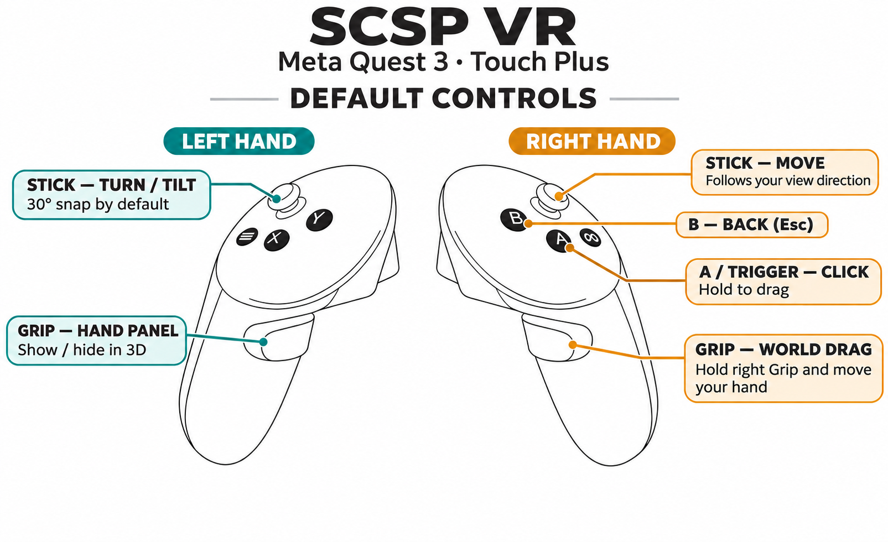

[English](../en/USAGE.md) | [한국어](../ko/USAGE.md) | [日本語](../ja/USAGE.md) · [README](../../README.md) · [Installation](INSTALLATION.md)

# Display, controls, and settings

## Display modes

The mod switches between stereo 3D and aspect-correct flat panels. Supported sources include 3D Live, Photo Studio, and OurStream, with matching Home, costume, and story camera layouts also recognized by the runtime. This does not guarantee every screen in those modes: an unsupported or changing source can return to the flat panel. Live pause retains a safe established stereo source. Video and ordinary menus use a flat panel.

In stereo, show the hand panel with **left Grip**, raise the tracked left hand into view, and point at it with the right controller. It starts hidden. The automatic front panel used outside stereo is separate; the hand-panel toggle does not hide it. You can change the panel hand, pointer hand, starting visibility, size, position, rotation, and viewer-facing behavior.

OurStream's initial waiting screen can be black in stereo. Skip it using PC controls or the hand panel. Its initial viewpoint can be at world origin, including below the floor. Use movement and turning to position yourself after entering.

## Default controls

Controller artwork: [Meta](../images/README.md).

These are the packaged defaults for a fresh installation with Touch-style controllers. Updates preserve existing settings.

| Action | Input |
|---|---|
| Point at the panel | Right controller aim |
| Click / drag | A or right trigger; hold while moving to drag |
| Back | B, while pointing at a panel; sends `Esc` |
| Show / hide the stereo hand panel | Left Grip; release before toggling again |
| Move | Right stick; head-relative direction |
| Turn | Left stick; 30° snap |
| World drag | Hold right Grip and move the right hand |

Bring the game window to the foreground for clicks and back input. The pointer must intersect a presented panel. If the trigger shakes your aim, try **A**. A mouse can also operate the game. With the pointer hand changed to the left, the default primary/secondary face-button choices correspond to **X/Y** rather than A/B. Buttons can be reassigned in settings.

Thumbstick scrolling is **off by default**, but an optional setting sends mouse-wheel input from the pointer hand's stick. If this shares the movement stick, the same input can also move you; leave it off unless you need it. Direct hand touch, stick-click recenter/camera-follow toggles, and an in-headset settings menu are not provided by this controller implementation.

## Movement and fine positioning

Move the view stick horizontally for yaw or vertically for pitch. Return it to center between snap turns. Stick movement follows the current view direction, including head orientation and view-stick adjustments. Look up or down and push forward to move vertically. Default speed is **1.95 m/s** before spatial-profile scaling. The movement hand is configurable; turning uses the opposite hand. Turning can be enabled independently of stick movement, with smooth turning or **15° / 30° / 45° / 60°** snap angles. Default snap is 30°; default smooth-turn speed is 90°/s when selected.

World drag is enabled in new defaults. Existing files explicitly setting it to `false` remain disabled; if the setting is absent, the new default applies. For fine positioning or to check an older setup:

1. Close the game and open `game directory\vrmod\tools\SongPrismVR.Configurator.exe`.
2. In **Input**, check **Enable world dragging**; enable it if an existing setting has it off. Keep **Right Grip** as the activator and **Track right hand** selected for the simplest setup.
3. Save, restart the game, and enter a stereo scene.
4. Hold right Grip and move the right hand. The viewpoint moves opposite to your hand, as if pulling the world. Release to keep the offset. Repeat as needed; stick movement can be used at the same time.

The activator and tracked hand can be set independently, including left/right Grip or Trigger activators. If both tracked hands are selected, the activator's hand is preferred when enabled. The first eligible press owns the drag until release or tracking loss; two hands do not add their motion together.

**Input conflicts:** a Grip assigned to panel toggling cannot start world drag. The pointer trigger is reserved for clicking while pointing at a presented panel. After an input is consumed or tracking is lost, release and press again to resume. Using right Grip with the default left-Grip panel toggle avoids that Grip conflict.

Live normally reflects head position and rotation (6DoF) and does not synchronize your position to the game's camera. To follow the camera position, use **Synchronize to game camera position** in **VR / Rendering**, then save and restart. This changes the Live position policy; it is not a stick-click action.

## Change and preserve settings

Close the game before saving. Select the correct game directory in the configurator, adjust values, select **Save**, and relaunch. Opening the configurator also runs its [automatic update check](INSTALLATION.md#update), including prereleases, without an Update / Later prompt.

| Area | Available adjustments |
|---|---|
| VR / Rendering | Enable VR, per-eye render scale 0.50–2.00 (default 0.65), world eye offset, Live camera-position synchronization, VFX |
| Space / Scale | Separate Live/non-Live character/world size (default 100%), automatic or manual eye/head/stick movement scales |
| Hand panel | Panel/pointer hands, initial visibility, viewer-facing, offsets, maximum dimensions, rotation, toggle button |
| Input | Click/back binding, trigger click, optional stick scroll, foreground requirement, movement, world drag, view turn |

Increase render scale gradually: above 1.00, rendering exceeds the OpenXR-recommended resolution and GPU load increases. VFX is **all off by default**; individual effects can be selected manually. Spatial profiles change perceived scale and movement, so tune them separately from image resolution. Automatic spatial scaling compensates inversely for character/world size.

The saved file is `game directory\vrmod\config\settings.json`. **Export** saves a separate copy. **Import** loads values into the app; **Save** applies them to the game folder. **Defaults** also requires **Save**. **Reload** reads the saved file. Updating does not reset old settings.

For display problems, see [troubleshooting](../../README.md#troubleshooting) and [known limitations](../DEVELOPMENT.md). Close the game before [uninstalling or rolling back](INSTALLATION.md#uninstall-and-rollback).
