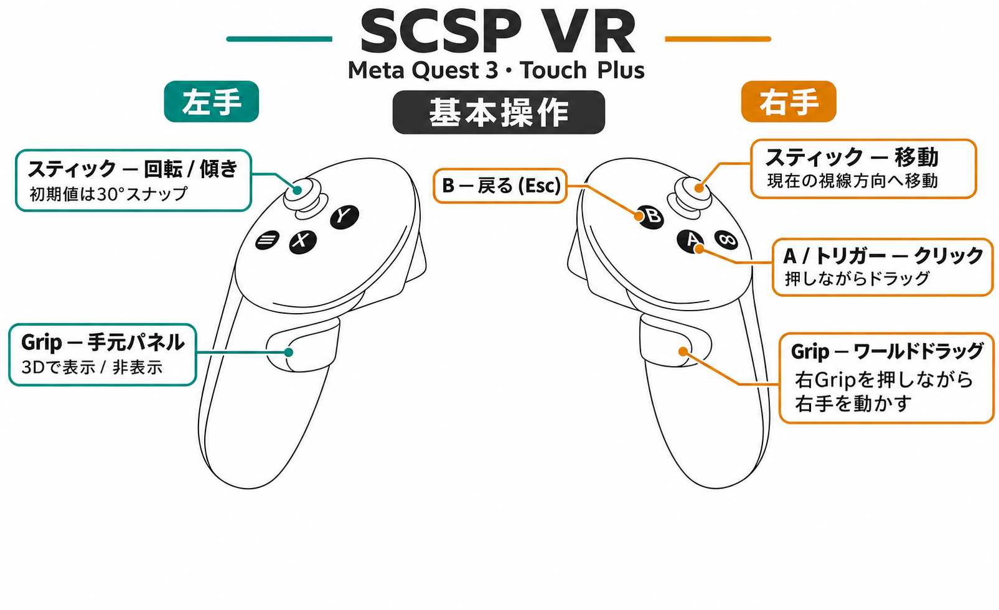

[English](../en/USAGE.md) | [한국어](../ko/USAGE.md) | [日本語](../ja/USAGE.md) · [README](../../README.ja.md) · [インストール](INSTALLATION.md)

# 表示・操作・設定

## 表示方式

対応する出力に応じて両眼3Dと比率を維持した平面パネルを切り替えます。3Dライブ・フォトスタジオ・OurStreamに対応し、ホーム・衣装・ストーリーの対応カメラ構成も認識します。各モードのすべての画面を保証するものではなく、非対応または切り替え中の出力は平面に戻る場合があります。ライブの一時停止中は安全に保持できる既存のステレオ出力を維持します。動画と通常のメニューは平面パネルです。

ステレオでは**左Grip**で手元パネルを表示し、追跡中の左手を視野に入れて右コントローラーで指します。初期状態は非表示です。ステレオ以外で自動表示する正面パネルは別で、この切り替えでは隠せません。パネルとポインター側の手、初期表示、サイズ・位置・回転・プレイヤー向きを変更できます。

OurStreamの最初の待機画面は黒いステレオになる場合があります。PC操作または手元パネルでスキップしてください。初期視点がワールド原点や床下になる場合は、開始後に移動と回転で調整してください。

## デフォルト操作

コントローラー図： [Meta](../images/README.md)。

Touch系コントローラーを使う新規インストール時の配布初期値です。更新時は既存設定を保持します。

| 操作 | 入力 |
|---|---|
| パネルを指す | 右コントローラー |
| クリック／ドラッグ | Aまたは右トリガー。押しながら動かすとドラッグ |
| 戻る | パネルを指しながらB。`Esc`を送信 |
| ステレオ手元パネルの表示／非表示 | 左Grip。次の切り替えは一度離してから押す |
| 移動 | 右スティック。頭の向き基準 |
| 回転 | 左スティック。30°スナップ |
| ワールドドラッグ | 右Gripを押しながら右手を動かす |

クリックと戻る操作には、ゲームを最前面にして表示中のパネルを指してください。トリガーで照準がずれる場合は**A**を使ってください。マウスも使えます。ポインター側を左手にすると、初期の主／副ボタンはA/Bの代わりに**X/Y**に対応します。設定で変更できます。

スティックスクロールは**初期状態ではOFF**ですが、有効化するとポインター側のスティックからマウスホイール入力を送ります。移動側と同じ場合は同時に移動するため、必要な場合だけ有効にしてください。この入力実装には、直接の手によるタッチ、スティック押し込みによるリセンター・カメラ追従切り替え、ヘッドセット内の設定メニューはありません。

## 移動と微調整

回転スティックの左右で左右の回転、上下で視点の傾きを調整します。スナップを繰り返すには中央へ戻します。移動スティックは頭の向きとスティック回転を反映した現在の視線方向に従います。上や下を見て前進すると上下に移動できます。空間プロファイル倍率適用前の初期速度は**1.95 m/s**です。移動側を変更すると反対の手が回転を担当します。回転はスティック移動と独立して有効にでき、スムーズ回転または**15° / 30° / 45° / 60°**のスナップを選べます。初期スナップは30°、スムーズ回転選択時の初期速度は90°/sです。

新しい初期値ではワールドドラッグが有効です。既存ファイルに`false`が明記されていれば無効のまま保持し、項目がなければ新しい初期値を使います。微調整や既存設定の確認には：

1. ゲームを終了し、`ゲームフォルダー\vrmod\tools\SongPrismVR.Configurator.exe`を開きます。
2. **操作**で**ワールドドラッグを使用**を確認し、既存設定で無効なら有効にします。最初は開始ボタンを**右手 Grip**、追跡する手を**右手を追跡**のままにします。
3. 保存し、ゲームを再起動してステレオシーンに入ります。
4. 右Gripを押しながら右手を動かすと、ワールドを引くように視点が手と反対方向に移動します。離すと位置を保持します。繰り返し操作でき、スティック移動とも併用できます。

開始ボタンと追跡する手は独立して指定でき、左右のGripまたはTriggerを選べます。両手の追跡を選んだ場合は開始ボタン側の手を優先します。最初の有効な押下が、解放または追跡喪失までドラッグを担当します。両手の移動を加算するものではありません。

**入力の競合：** パネル切り替えに割り当てたGripはワールドドラッグを開始しません。ポインタートリガーはパネルを指している間、クリックを優先します。入力が別の操作に使われた場合や追跡喪失後は、一度離して押し直してください。初期の左Gripパネルと右Gripドラッグの組み合わせなら、そのGrip競合を避けられます。

ライブは通常、頭の位置・回転を反映する6DoFを使い、位置をゲームカメラに同期しません。カメラ位置へ追従するには**VR・レンダリング**のゲームカメラ位置に同期する設定を変更し、保存・再起動します。ライブの位置方針の設定であり、スティック押し込みでは切り替えません。

## 設定の変更と保持

保存前にゲームを終了します。設定アプリで正しいゲームフォルダーを選び、変更して**保存**し、ゲームを再起動します。アプリ起動時にはプレリリースを含む[自動更新の確認](INSTALLATION.md#更新)も実行し、「更新／後で」の確認はありません。

| 分類 | 変更できる項目 |
|---|---|
| VR・レンダリング | VR有効化、レンダー倍率0.50～2.00（初期0.65）、目の間隔、ライブカメラ位置同期、VFX |
| 空間・サイズ | ライブ／非ライブ別のキャラクター・ワールドサイズ（初期100%）、自動／手動の目・頭・スティック移動倍率 |
| ハンドパネル | パネル／ポインター側、初期表示、プレイヤー向き、位置・最大サイズ・回転・切り替えボタン |
| 操作 | クリック／戻る、トリガー、任意のスクロール、最前面条件、移動・ワールドドラッグ・視点回転 |

レンダー倍率は少しずつ上げてください。1.00を超えるとOpenXR推奨解像度を上回り、GPU負荷が増えます。VFXは**初期状態ですべてOFF**で、個別に手動選択できます。空間プロファイルは体感サイズと移動を変えるため、解像度とは分けて調整します。自動空間倍率はキャラクター／ワールドサイズの逆数で補正します。

保存先は`ゲームフォルダー\vrmod\config\settings.json`です。**エクスポート**は別のコピーを保存します。**インポート**はアプリへ読み込む操作なので、ゲームフォルダーに適用するには**保存**が必要です。**初期値**も保存が必要で、**再読み込み**は保存済みファイルを読みます。更新で既存設定は初期化されません。

表示の問題は[症状別の対処](../../README.ja.md#困ったとき)と[制限事項](../DEVELOPMENT.md)を確認してください。[削除とロールバック](INSTALLATION.md#uninstall-and-rollback)の前にはゲームを終了します。
