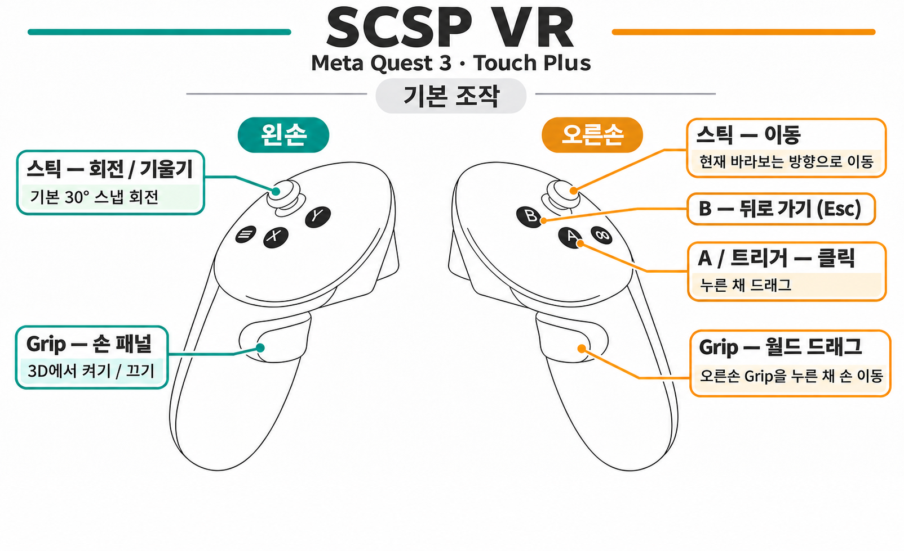

[English](../en/USAGE.md) | [한국어](../ko/USAGE.md) | [日本語](../ja/USAGE.md) · [README](../../README.ko.md) · [설치 안내](INSTALLATION.md)

# 화면·조작·설정 안내

## 화면 표시 방식

지원되는 출력에 따라 양안 3D와 비율을 유지한 평면 패널을 전환합니다. 3D 라이브·포토 스튜디오·OurStream을 지원하며, 홈·의상·스토리의 대응 카메라 구성도 인식합니다. 해당 모드의 모든 화면을 보장하는 것은 아니며, 지원하지 않거나 전환 중인 출력은 평면 패널로 돌아갈 수 있습니다. 라이브 일시 정지 시 안전하게 유지할 수 있는 기존 스테레오 출력은 유지합니다. 영상과 일반 메뉴는 평면 패널로 표시합니다.

스테레오에서는 **왼손 Grip**으로 손 패널을 켜고, 추적 중인 왼손을 시야 안에 든 뒤 오른손으로 가리켜 조작합니다. 기본적으로 꺼져 있습니다. 스테레오 밖에서 자동 표시되는 정면 패널은 별개로, 손 패널 토글로 숨기지 않습니다. 패널·포인터 손, 시작 상태·크기·위치·회전·플레이어 방향 정렬을 설정할 수 있습니다.

OurStream 초기 대기 화면은 검은 스테레오로 나타날 수 있습니다. PC 조작이나 손 패널로 넘기십시오. 초기 시점이 월드 원점이나 바닥 아래에 놓일 수 있으므로 진입 후 이동과 시야 회전으로 조정하십시오.

## 기본 조작

컨트롤러 도해: [Meta](../images/README.md).

Touch 계열 컨트롤러로 새로 설치했을 때의 배포 기본값입니다. 업데이트는 기존 설정을 유지합니다.

| 동작 | 입력 |
|---|---|
| 패널 조준 | 오른손 컨트롤러로 가리키기 |
| 클릭 / 드래그 | A 또는 오른손 트리거. 누른 채 움직이면 드래그 |
| 뒤로 가기 | 패널을 가리키며 B. `Esc` 전달 |
| 스테레오 손 패널 켜기 / 끄기 | 왼손 Grip. 다시 전환하려면 놓았다가 누르기 |
| 이동 | 오른손 스틱. 머리 방향 기준 |
| 회전 | 왼손 스틱. 30° 스냅 |
| 월드 드래그 | 오른손 Grip을 누른 채 오른손 이동 |

클릭·뒤로가기를 사용하려면 게임 창을 포그라운드로 옮기고, 표시된 패널을 포인터로 가리켜야 합니다. 트리거를 당길 때 조준이 흔들리면 **A**를 사용하십시오. 마우스도 사용할 수 있습니다. 포인터 손을 왼손으로 바꾸면 기본 주/보조 표면 버튼이 A/B 대신 **X/Y**에 대응합니다. 버튼은 설정에서 바꿀 수 있습니다.

스틱 스크롤은 **기본 꺼짐**이지만, 켜면 포인터 손의 스틱으로 마우스 휠 입력을 보냅니다. 이동 스틱과 같다면 동시에 이동할 수 있으니 필요한 경우에만 켜십시오. 이 컨트롤러 구현에는 직접 손 터치, 스틱 클릭 재정렬·카메라 추종 전환, 헤드셋 안 설정 메뉴가 없습니다.

## 이동과 미세 조정

회전 스틱의 좌우는 좌우 회전, 위·아래는 시야 기울기를 조정합니다. 스냅을 반복하려면 중앙으로 되돌리십시오. 이동 스틱은 머리 방향과 스틱 회전을 반영한 현재 시야 방향을 따릅니다. 위나 아래를 보면서 전진하면 수직 이동할 수 있습니다. 기본 속도는 공간 프로필 배율 적용 전 **1.95 m/s**입니다. 이동 손을 바꾸면 반대 손이 회전을 담당합니다. 회전은 스틱 이동과 독립적으로 켤 수 있으며, 연속 회전 또는 **15° / 30° / 45° / 60°** 스냅을 선택합니다. 스냅 기본값은 30°이며, 연속 회전을 선택했을 때의 기본 속도는 90°/s입니다.

새 기본값에서는 월드 드래그가 켜져 있습니다. 기존 파일에 `false`가 명시되어 있으면 꺼짐을 유지하고, 항목이 없으면 새 기본값을 적용합니다. 미세 조정이나 기존 설정 확인은 다음과 같이 합니다.

1. 게임을 종료하고 `게임 폴더\vrmod\tools\SongPrismVR.Configurator.exe`를 엽니다.
2. **조작** 탭에서 **월드 드래그 사용**을 확인하고, 기존 설정에서 꺼져 있으면 켭니다. 처음에는 활성화 버튼을 **오른손 Grip**, 움직임 추적을 **오른손 추적**으로 유지합니다.
3. 저장하고 게임을 다시 실행해 스테레오 장면에 들어갑니다.
4. 오른손 Grip을 누른 채 오른손을 움직이면 월드를 잡아당기는 것처럼 시점이 손의 반대 방향으로 움직입니다. 놓으면 위치가 유지됩니다. 필요에 따라 반복하고 스틱 이동도 함께 사용할 수 있습니다.

활성화 버튼과 추적 손은 독립적으로 지정하며, 왼손·오른손 Grip 또는 Trigger를 선택할 수 있습니다. 추적 손을 둘 다 선택하면 활성화한 버튼 쪽 손을 우선합니다. 먼저 유효하게 누른 버튼이 해제되거나 추적이 끊길 때까지 드래그를 담당하며, 두 손의 이동을 합산하지 않습니다.

**입력 충돌:** 손 패널 토글에 지정한 Grip은 월드 드래그를 시작하지 않습니다. 포인터 트리거는 패널을 가리킬 때 클릭에 우선 사용됩니다. 입력이 다른 동작에 사용되거나 추적이 끊긴 뒤에는 놓았다가 다시 누르십시오. 기본 왼손 Grip 패널 토글과 오른손 Grip 드래그 조합은 Grip 충돌을 피할 수 있습니다.

라이브는 기본적으로 머리 위치·회전을 반영하는 6DoF를 사용하며, 위치를 게임 카메라에 동기화하지 않습니다. 카메라 위치를 따라가려면 **VR/렌더**의 **게임 카메라 위치에 동기화**를 바꾸고 저장·재실행합니다. 라이브 위치 정책 설정이며 스틱 클릭으로 전환하는 기능이 아닙니다.

## 설정 변경과 보존

설정 저장 전에 게임을 종료합니다. 설정 앱에서 올바른 게임 폴더를 선택하고 값을 바꾼 뒤 **저장**하고 재실행합니다. 설정 앱은 열릴 때 프리릴리스를 포함한 [자동 업데이트 확인](INSTALLATION.md#업데이트)도 실행하며, ‘업데이트 / 나중에’ 확인 창이 없습니다.

| 영역 | 바꿀 수 있는 항목 |
|---|---|
| VR/렌더 | VR 사용 여부, 눈별 렌더 배율 0.50~2.00(기본 0.65), 월드 눈 간격, 라이브 카메라 위치 동기화, VFX |
| 공간/크기 | 라이브·비라이브별 캐릭터/월드 크기(기본 100%), 자동·수동 눈 간격·머리·스틱 이동 배율 |
| 손 패널 | 패널·포인터 손, 시작 상태, 플레이어 방향 정렬, 오프셋·최대 크기·회전·토글 버튼 |
| 조작 | 클릭·뒤로 버튼, 트리거 클릭, 선택적 스틱 스크롤, 활성 창 조건, 이동·월드 드래그·시야 회전 |

렌더 배율은 조금씩 올리십시오. 1.00 초과는 OpenXR 권장 해상도를 넘겨 GPU 부하가 증가합니다. VFX는 **기본 모두 꺼짐**이며 개별 효과를 수동 선택할 수 있습니다. 공간 프로필은 체감 크기와 이동을 바꾸므로 해상도와 구분해 조절합니다. 자동 공간 배율은 캐릭터/월드 크기의 역수로 보정합니다.

저장 파일은 `게임 폴더\vrmod\config\settings.json`입니다. **내보내기**는 별도 복사본을 저장합니다. **가져오기**는 앱에 값을 불러오므로 게임 폴더에 적용하려면 **저장**이 필요합니다. **기본값**도 저장해야 적용되며, **다시 읽기**는 저장 파일을 읽습니다. 업데이트는 기존 설정을 초기화하지 않습니다.

표시 문제는 [증상별 해결법](../../README.ko.md#증상별-문제-해결)과 [알려진 제한](../DEVELOPMENT.md)을 확인하십시오. [제거·롤백](INSTALLATION.md#uninstall-and-rollback) 전에는 게임을 종료합니다.
